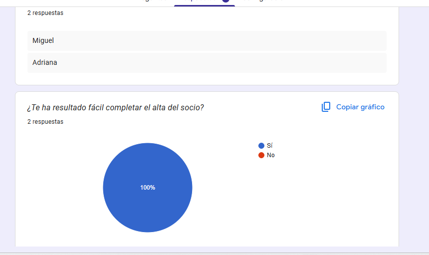
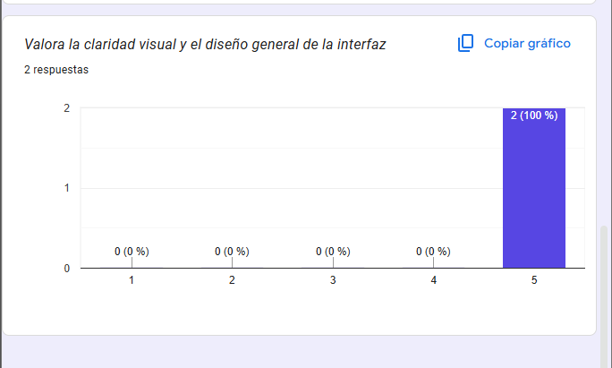

# Práctica 6-7 · Rescata GymFit Manager (Desarrollo de Interfaces)

Repositorio oficial para el rediseño y evaluación de usabilidad de la aplicación de escritorio **GymFit Manager**.

## 🚀 Contenido del Proyecto
* **Evaluación Heurística (Parte 1):** Análisis de 8 problemas de usabilidad de la interfaz original basándose en los Temas 6 y 7, con sus respectivas propuestas de mejora.
* **Rediseño en Scene Builder (Parte 2):** Aplicación de escritorio desarrollada en JavaFX (Java 17) con una interfaz de 1280x800, paleta de colores corporativa (tonos verdes), barra de menús estándar con atajos, menú contextual simplificado y formulario optimizado con controles nativos (`DatePicker`, `ComboBox`, `RadioButtons`).
* **Test con Usuarios (Parte 3):** Pruebas de usabilidad realizadas con dos usuarios reales midiendo tiempo, tasa de éxito, errores y satisfacción, complementadas mediante valoración externa.
* * **Cuestionario de Valoración:** [Acceso al Formulario de Google Forms para la evaluación de usuarios](https://docs.google.com/forms/d/e/1FAIpQLSfhCqswo4F_e78BqZuLCJcnKutdctLNdBNpcqJnXIZRaNoIfA/viewform?usp=dialog)
### 📊 Evidencias del Cuestionario de Usuarios
A continuación se muestran las capturas de las respuestas obtenidas en el formulario de valoración:

)

* **Memoria Completa:** Documentación en formato PDF ubicada en la raíz del repositorio (`DI_T67_Martin_Blanco_Jose_Luis.pdf`).
## 🛠️ Tecnologías Utilizadas
* Java 17 / JavaFX 21
* IntelliJ IDEA & Scene Builder
* GitHub